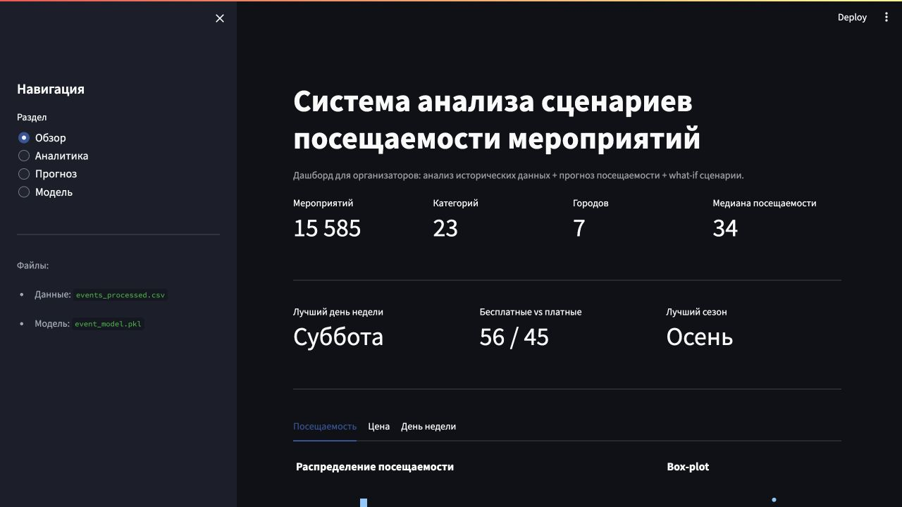
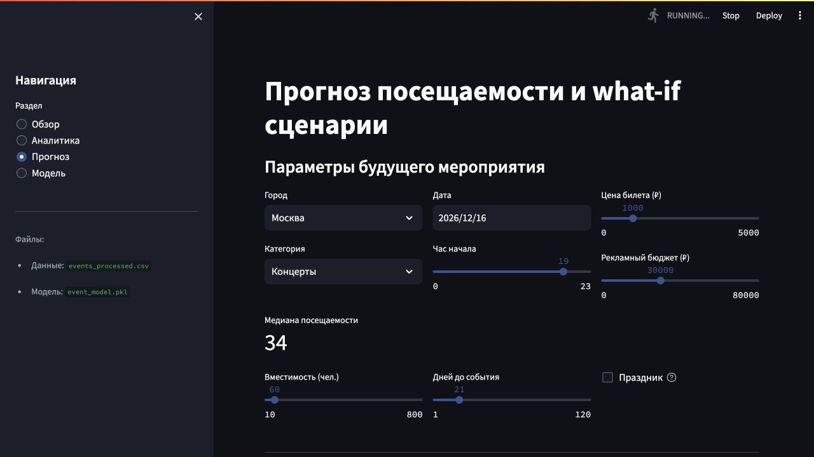
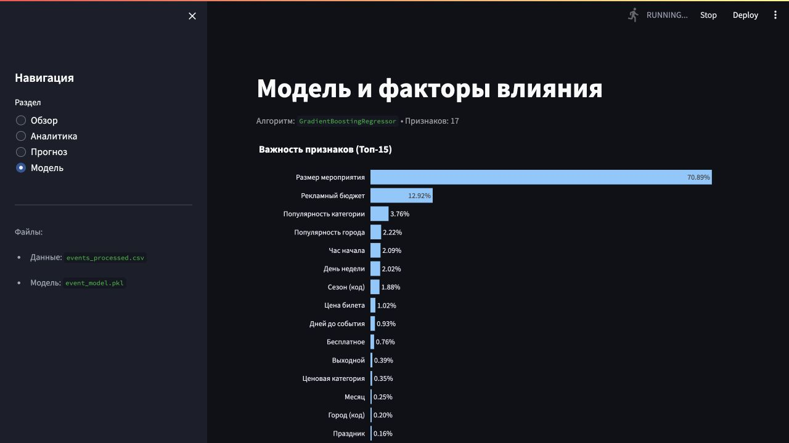
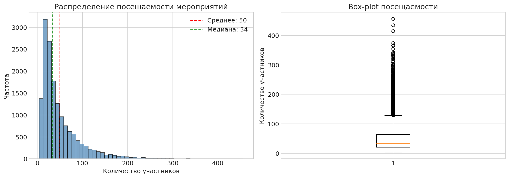
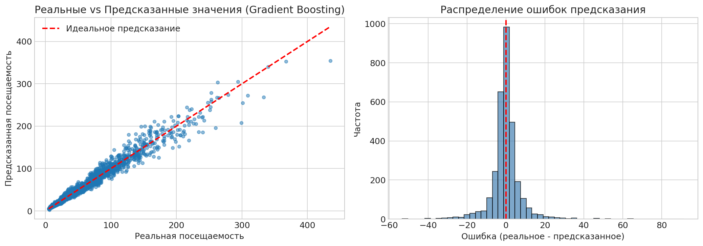
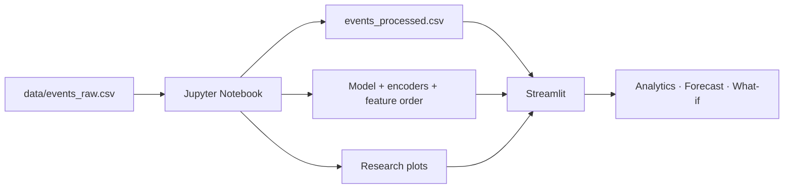

<p align="right"><a href="README.md">RU</a> · <b>EN</b></p>
<h1 align="center">Event Attendance Optimizer</h1>
<p align="center">Machine Learning · Data Analytics · Interactive Dashboard</p>
<p align="center">Attendance forecasts and what-if analysis for event organizers.</p>
<p align="center"></p>
<p align="center"><br><sub>Public deployment pending. <a href="#quick-start">Run locally</a></sub></p>
<p align="center"><a href="event_analysis.ipynb">Jupyter Notebook ↗</a>　·　<a href="data/events_processed.csv">Dataset ↗</a>　·　<a href="streamlit_app.py">Source Code ↗</a></p>

---

## About the project

How many people might attend, and how would the estimate change with a Saturday date or a lower ticket price? The dashboard helps organizers compare options before booking a venue. Filter past events by city, category and year, then enter a planned event to get an estimate in people.

## Key features

| Feature | Capability |
|:--|:--|
| ▥ **Data Analytics** | Explore attendance distributions, seasonality, ticket prices and categories. |
| ƒ **Machine Learning** | Estimate attendance from 17 event features. |
| ⇄ **What-if Analysis** | Vary ticket price, ad spend, lead time or weekday and compare predictions. |
| ▤ **Feature Importance** | Inspect the fitted model’s 15 highest-ranked inputs. |

## Application Preview

**Overview · 15,585 events with a median attendance of 34**



| Forecast inputs | Model factors |
|:--|:--|
| [](assets/forecast.jpg) | [](assets/model.jpg) |

## Dataset

The study starts from Timepad event listings dated 2019–2023. The research data combines listing metadata with synthetic attributes. A supplied script generates city, price, budget, capacity, registrations and attendance. Its archived output shares event IDs with the notebook input, but attendance values differ. Use the notebook input when interpreting the reported metrics.

| File | Contents |
|:--|:--|
| [data/events_raw.csv](data/events_raw.csv) | Notebook input. 15,585 rows × 20 columns, 23 categories and 7 city labels including “Other”. |
| [data/events_processed.csv](data/events_processed.csv) | Dashboard input. 15,585 rows × 26 columns including derived features. |
| [events_final_dataset_synthetic.csv](events_final_dataset_synthetic.csv) | Archived synthetic dataset. The collection export and intermediate cleaned file are also available at the repository root. |

## Machine Learning

The target, `participants`, counts attendees. The notebook checks missing values and duplicates, explores distributions and correlations, and derives categories from start time, price and capacity. Mean attendance by city and category adds two numeric predictors. LabelEncoder maps categories to integers.

Three regressors were compared on a random 80/20 split (`random_state=42`, 3,117 test events). GradientBoostingRegressor, with 200 trees of maximum depth 6, achieved the lowest MAE. The dashboard loads the fitted model, encoders and feature order with joblib.

## Model Performance

| Model | MAE ↓ | RMSE ↓ | MAPE ↓ | R² ↑ |
|:--|--:|--:|--:|--:|
| Linear Regression | 9.49 | 15.61 | 25.05% | 0.881 |
| Random Forest | 6.31 | 11.43 | 12.50% | 0.936 |
| **Gradient Boosting** | **4.66** | **8.11** | **9.37%** | **0.968** |

MAE and RMSE are measured in attendees. For gradient boosting, the mean absolute difference between prediction and target was 4.66 people. City and category means were computed before the split, so test targets contributed to the features. These scores describe the research experiment. Performance on future real events requires independent validation. [Notebook](event_analysis.ipynb)

## Data Visualization

| Attendance distribution | Predictions and residuals |
|:--|:--|
| [](plots/01_distribution_participants.png) | [](plots/08_predictions_analysis.png) |

Browse all nine research figures, including seasonality, correlations and model comparisons. [Plots ↗](plots/)

## System Architecture



## Technology Stack

**Python 3.12** · pandas · NumPy · scikit-learn 1.5.1 · joblib · Streamlit · Plotly · Jupyter · Matplotlib · seaborn

## Project Structure

```text
streamlit_app.py                  Four dashboard pages
event_analysis.ipynb              Research and training results
data/                             Notebook and dashboard datasets
*.pkl                             Fitted model, encoders, feature order
events_*.csv                      Archived data preparation stages
scripts/                          Timepad collector, generator and app check
plots/                            Nine research figures
assets/                           Screenshots and repository artwork
```

## Quick Start

From the repository root, using Python 3.12

```bash
python3.12 -m venv .venv
source .venv/bin/activate
python -m pip install -r requirements.txt
python -m streamlit run streamlit_app.py
```

On Windows PowerShell, activate the environment with `.venv\Scripts\Activate.ps1`. Open the local address printed in the terminal. The repository includes the data and fitted model. To check all four pages and what-if scenarios, run `python scripts/check_dashboard.py`.

## Author

[kziborova · GitHub](https://github.com/kziborova)
