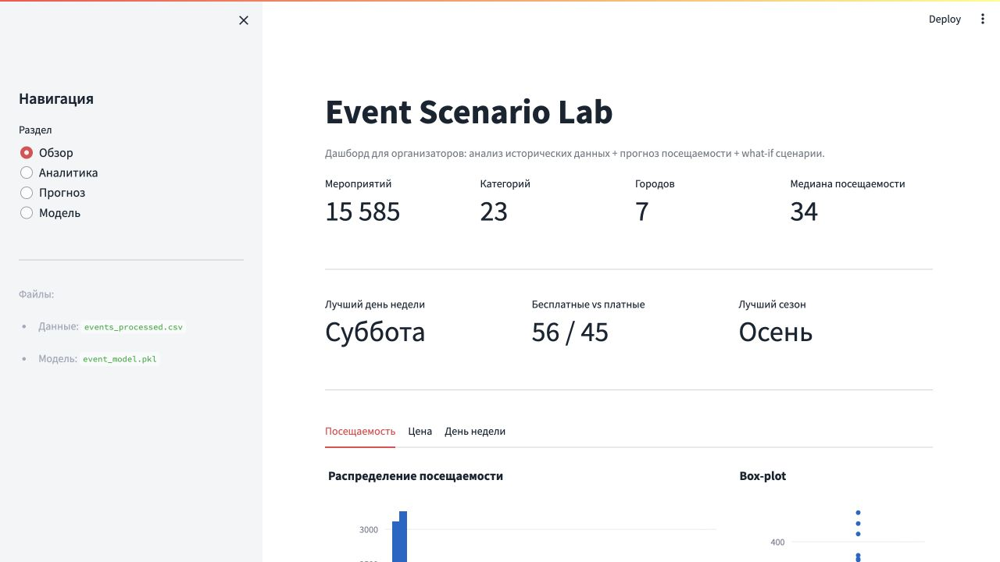
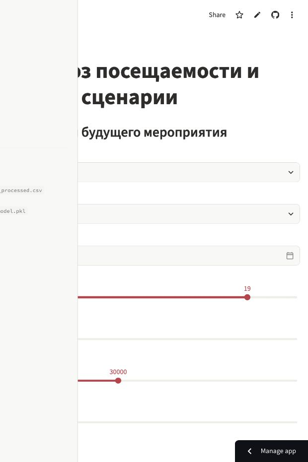
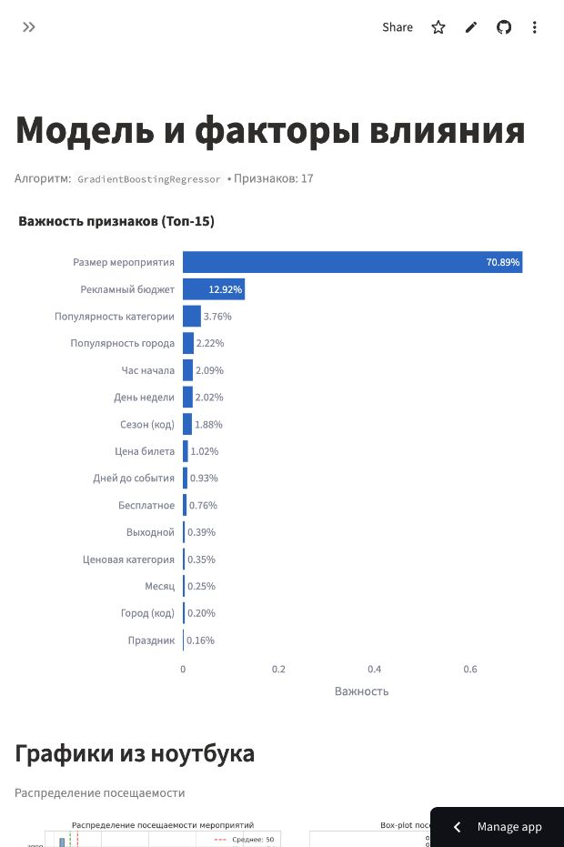
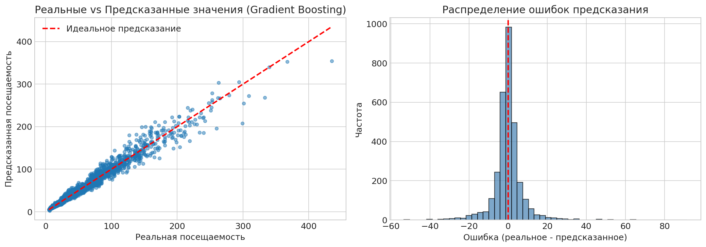

<h1 align="center">Event Scenario Lab</h1>
<p align="center">Machine Learning · Data Analytics · Interactive Dashboard</p>
<p align="center">Прогноз посещаемости мероприятий и сценарный анализ для организаторов.</p>
<p align="center"></p>
<p align="center"><a href="https://event-scenario-lab.streamlit.app/"></a></p>
<p align="center"><a href="event_analysis.ipynb">Jupyter Notebook ↗</a>　·　<a href="data/events_processed.csv">Dataset ↗</a>　·　<a href="streamlit_app.py">Source Code ↗</a></p>

---

## About the project

Сколько участников ожидать и как изменится прогноз, если перенести событие на субботу или снизить цену билета? Дашборд помогает организатору сравнить варианты до бронирования площадки. Исследование охватывает 15 585 мероприятий Timepad за 2019–2023 годы. Данные сочетают сведения из карточек событий и синтетические показатели, включая посещаемость.

## Key features

| Инструмент | Что можно узнать |
|:--|:--|
| ▥ **Data Analytics** | Распределение посещаемости, сезонность и срезы по цене и категориям. |
| ƒ **Machine Learning** | Прогноз числа участников по 17 признакам мероприятия. |
| ⇄ **What-if Analysis** | Меняйте цену, рекламный бюджет, срок до события или день недели и сравнивайте прогнозы. |
| ▤ **Feature Importance** | Рейтинг 15 ведущих признаков сохранённой модели. |

## Application Preview

**Обзор · 15 585 событий, медиана — 34 участника**



| Параметры прогноза | Факторы модели |
|:--|:--|
| [](plots/forecast.jpg) | [](plots/model.jpg) |

## Machine Learning

Целевая переменная `participants` — число участников. В ноутбуке проверены пропуски и дубликаты, исследованы распределения и корреляции. Из времени начала, цены и вместимости получены категориальные признаки. Для города и категории добавлена средняя посещаемость. Категории закодированы с помощью LabelEncoder.

На случайном разбиении 80/20 (`random_state=42`, 3 117 тестовых событий) сравнили три регрессора. GradientBoostingRegressor с 200 деревьями глубиной до 6 дал наименьшую MAE. Дашборд загружает сохранённую модель, кодировщики и порядок признаков через joblib.

| Модель | MAE ↓ | RMSE ↓ | MAPE ↓ | R² ↑ |
|:--|--:|--:|--:|--:|
| Linear Regression | 9.49 | 15.61 | 25.05% | 0.881 |
| Random Forest | 6.31 | 11.43 | 12.50% | 0.936 |
| **Gradient Boosting** | **4.66** | **8.11** | **9.37%** | **0.968** |

MAE и RMSE измеряются в участниках. Для бустинга абсолютное отклонение прогноза от цели в среднем составило 4,66 человека. Средняя посещаемость города и категории рассчитана до разбиения выборки, поэтому в признаках есть информация о тестовых целях. Результаты относятся к этому учебному эксперименту. Качество на будущих реальных событиях требует отдельной проверки. [Notebook](event_analysis.ipynb)

| Распределение посещаемости | Прогнозы и остатки |
|:--|:--|
| [](plots/01_distribution_participants.png) | [](plots/08_predictions_analysis.png) |

## Quick Start

Из корня репозитория, в Python 3.12

```bash
python3.12 -m venv .venv
source .venv/bin/activate
python -m pip install -r requirements.txt
python -m streamlit run streamlit_app.py
```

В Windows PowerShell активируйте окружение командой `.venv\Scripts\Activate.ps1`. Откройте локальный адрес из терминала. Данные и модель входят в репозиторий. Проверка четырёх страниц и сценариев `python scripts/check_dashboard.py`.

[kziborova · GitHub](https://github.com/kziborova)
