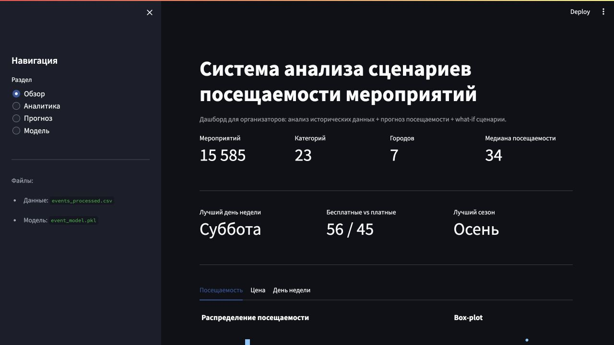
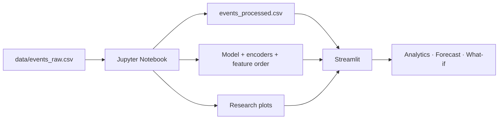

<p align="right"><b>RU</b> · <a href="README.en.md">EN</a></p>
<h1 align="center">Event Attendance Optimizer</h1>
<p align="center">Machine Learning · Data Analytics · Interactive Dashboard</p>
<p align="center">Прогноз посещаемости мероприятий и сценарный анализ для организаторов.</p>
<p align="center"></p>
<p align="center"><br><sub>Публичная версия ожидает публикации. <a href="#quick-start">Запустить локально</a></sub></p>
<p align="center"><a href="event_analysis.ipynb">Jupyter Notebook ↗</a>　·　<a href="data/events_processed.csv">Dataset ↗</a>　·　<a href="streamlit_app.py">Source Code ↗</a></p>

---

## About the project

Сколько участников ожидать и как изменится прогноз, если перенести событие на субботу или снизить цену билета? Дашборд помогает организатору сравнить варианты до бронирования площадки. Можно изучить похожие мероприятия по городу, категории и году, затем задать параметры своего события и увидеть оценку в людях.

## Key features

| Feature | Возможности |
|:--|:--|
| ▥ **Data Analytics** | Распределение посещаемости, сезонность и срезы по цене и категориям. |
| ƒ **Machine Learning** | Прогноз числа участников по 17 признакам мероприятия. |
| ⇄ **What-if Analysis** | Меняйте цену, рекламный бюджет, срок до события или день недели и сравнивайте прогнозы. |
| ▤ **Feature Importance** | Рейтинг 15 ведущих признаков сохранённой модели. |

## Application Preview

**Обзор · 15 585 событий, медиана — 34 участника**



| Параметры прогноза | Факторы модели |
|:--|:--|
| [](assets/forecast.jpg) | [](assets/model.jpg) |

## Dataset

Основа исследования — карточки мероприятий Timepad за 2019–2023 годы. В учебных данных совмещены сведения о событиях и синтетические показатели. В проекте есть скрипт генерации города, цены, бюджета, вместимости, регистраций и посещаемости. Его сохранённый результат и вход ноутбука содержат те же идентификаторы событий, но значения посещаемости различаются. Для воспроизведения метрик используйте именно вход ноутбука.

| Файл | Содержимое |
|:--|:--|
| [data/events_raw.csv](data/events_raw.csv) | Вход ноутбука. 15 585 строк × 20 столбцов, 23 категории, 7 значений города, включая «Другие». |
| [data/events_processed.csv](data/events_processed.csv) | Данные приложения. 15 585 строк × 26 столбцов с производными признаками. |
| [events_final_dataset_synthetic.csv](events_final_dataset_synthetic.csv) | Сохранённая версия синтетического набора. Исходная выгрузка и промежуточная очистка также доступны в корне. |

## Machine Learning

Целевая переменная `participants` — число участников. В ноутбуке проверены пропуски и дубликаты, исследованы распределения и корреляции. Из времени начала, цены и вместимости получены категориальные признаки. Для города и категории добавлена средняя посещаемость. Категории закодированы с помощью LabelEncoder.

На случайном разбиении 80/20 (`random_state=42`, 3 117 тестовых событий) сравнили три регрессора. GradientBoostingRegressor с 200 деревьями глубиной до 6 дал наименьшую MAE. Дашборд загружает сохранённую модель, кодировщики и порядок признаков через joblib.

## Model Performance

| Модель | MAE ↓ | RMSE ↓ | MAPE ↓ | R² ↑ |
|:--|--:|--:|--:|--:|
| Linear Regression | 9.49 | 15.61 | 25.05% | 0.881 |
| Random Forest | 6.31 | 11.43 | 12.50% | 0.936 |
| **Gradient Boosting** | **4.66** | **8.11** | **9.37%** | **0.968** |

MAE и RMSE измеряются в участниках. Для бустинга абсолютное отклонение прогноза от цели в среднем составило 4,66 человека. Средняя посещаемость города и категории рассчитана до разбиения выборки, поэтому в признаках есть информация о тестовых целях. Результаты относятся к этому учебному эксперименту. Качество на будущих реальных событиях требует отдельной проверки. [Notebook](event_analysis.ipynb)

## Data Visualization

| Распределение посещаемости | Прогнозы и остатки |
|:--|:--|
| [](plots/01_distribution_participants.png) | [](plots/08_predictions_analysis.png) |

Все девять графиков исследования, включая сезонность, корреляции и сравнение моделей, доступны в галерее. [Plots ↗](plots/)

## System Architecture



## Technology Stack

**Python 3.12** · pandas · NumPy · scikit-learn 1.5.1 · joblib · Streamlit · Plotly · Jupyter · Matplotlib · seaborn

## Project Structure

```text
streamlit_app.py                  Четыре страницы дашборда
event_analysis.ipynb              Исследование и результаты обучения
data/                             Вход ноутбука и данные дашборда
*.pkl                             Модель, кодировщики, порядок признаков
events_*.csv                      Архивные этапы подготовки данных
scripts/                          Сбор Timepad, генератор и проверка приложения
plots/                            Девять графиков исследования
assets/                           Скриншоты и оформление
```

## Quick Start

Из корня репозитория, в Python 3.12

```bash
python3.12 -m venv .venv
source .venv/bin/activate
python -m pip install -r requirements.txt
python -m streamlit run streamlit_app.py
```

В Windows PowerShell активируйте окружение командой `.venv\Scripts\Activate.ps1`. Откройте локальный адрес из терминала. Данные и модель входят в репозиторий. Проверка четырёх страниц и сценариев `python scripts/check_dashboard.py`.

## Author

[kziborova · GitHub](https://github.com/kziborova)
